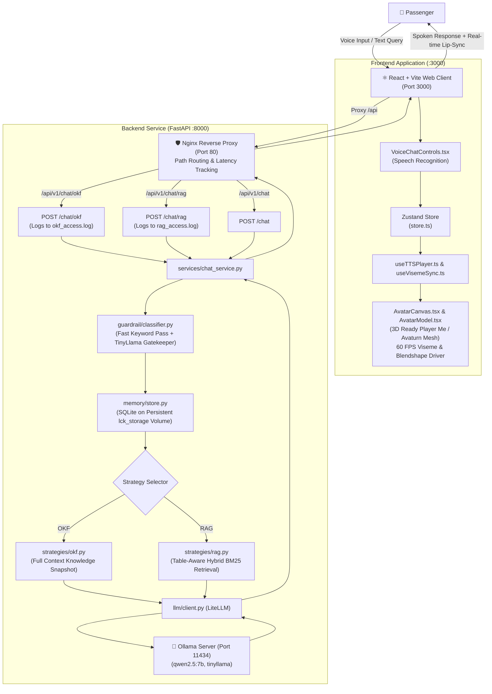

# 🛫 LCK Airport's AI Assistant

Official AI Talking Avatar and Passenger Kiosk Assistant for **Chaudhary Charan Singh International Airport (LCK / VILK)**, Lucknow, India.

---

## 📖 Documentation Directory

This repository contains beginner-friendly, detailed guides for each subsystem:

* 🐍 **Backend Developer Guide (FastAPI, Python 3.12, LiteLLM)**: [`backend/README.md`](file:///Users/chandrakumar/Documents/airport_project/lck_airport/backend/README.md)
* ⚛️ **Frontend Developer Guide (React, Vite, Three.js 3D Avatar)**: [`frontend/README.md`](file:///Users/chandrakumar/Documents/airport_project/lck_airport/frontend/README.md)
* 📂 **Knowledge Base & Corpus Guide**: [`data/README.md`](file:///Users/chandrakumar/Documents/airport_project/lck_airport/data/README.md)
* 📋 **Architectural Blueprints & Specs**: [`readme_files/`](file:///Users/chandrakumar/Documents/airport_project/lck_airport/readme_files/)

---

## 🏛️ System Architecture



---

## 📁 Repository Skeleton

```
lck_airport/
├── README.md               # Master Project Guide (You are here)
├── .gitignore              # Project-wide Git ignore rules
│
├── backend/                # FastAPI Python Backend
│   ├── README.md           # 📖 Step-by-step Python & FastAPI beginner guide
│   ├── compose.yaml        # Docker Compose configuration (FastAPI + Nginx)
│   ├── pyproject.toml      # Python dependencies & packaging
│   ├── .env.example        # Environment variable template
│   ├── .env                # Runtime configuration (git-ignored)
│   ├── docker/             # Dockerfiles for backend and Nginx reverse proxy
│   │   ├── Dockerfile      # Python 3.12-slim backend container
│   │   └── nginx/          # Nginx alpine reverse proxy with custom latency logging
│   └── src/                # Python application source code
│       ├── main.py         # Entry point, lifespan, CORS, router mounting
│       ├── api/            # REST API endpoints
│       │   └── routes/
│       │       ├── chat.py      # POST /chat, /chat/okf, /chat/rag
│       │       ├── health.py    # GET /health
│       │       ├── knowledge.py # GET /status, POST /refresh
│       │       └── audio.py     # POST /transcribe, /synthesize
│       ├── core/           # Configuration, structured logging, errors
│       ├── guardrail/      # Safety & prompt injection filter
│       ├── knowledge/      # In-memory snapshot manager
│       ├── llm/            # LiteLLM client wrapper for Ollama
│       ├── memory/         # Session store & SQLite persistence
│       ├── retrieval/      # Table-aware chunking & BM25 index
│       ├── schemas/        # Pydantic data models
│       ├── services/       # ChatService workflow orchestrator
│       └── strategies/     # OKF & RAG strategy implementations
│
├── frontend/               # React + Vite + TypeScript Web Client
│   ├── README.md           # 📖 Step-by-step React & 3D Three.js beginner guide
│   ├── index.html          # HTML template
│   ├── package.json        # NPM dependencies (@react-three/fiber, three, etc.)
│   ├── vite.config.ts      # Vite dev server and proxy configuration
│   ├── public/             # Static files (app icon, 3D avatar GLB models)
│   │   ├── app-icon.jpg    # Official airport assistant icon
│   │   └── avatars/        # 3D models with 72 facial viseme blendshapes
│   │       ├── lck_assistant.glb  # Officer 1: Customer Service Officer
│   │       └── avaturn.glb        # Officer 2: Photorealistic Avaturn Agent
│   └── src/
│       ├── App.tsx         # Main interactive kiosk application
│       ├── store.ts        # Global Zustand state store
│       ├── components/     # React UI components
│       │   ├── TranscriptList.tsx      # Conversation bubble list with verified citations
│       │   ├── avatar/AvatarCanvas.tsx # 3D Canvas, lighting, status badges, model toggle
│       │   ├── avatar/AvatarModel.tsx  # GLB loader, viseme blendshapes, blinking, head sway
│       │   ├── avatar/visemeMap.ts     # 15 Oculus visemes & phoneme mapping
│       │   └── voice/VoiceChatControls.tsx # Microphone button, quick chips, text input
│       └── hooks/
│           ├── useTTSPlayer.ts   # Web Speech API player with language matching
│           └── useVisemeSync.ts  # Frame-by-frame viseme interpolation
│
├── data/                   # Verified LCK Airport Knowledge Base
│   ├── README.md           # Corpus documentation & inventory guide
│   ├── manifest.json       # Declarative document inventory and checksum rules
│   ├── unknown_traps.json  # Benchmark questions to test closed-world abstention
│   └── lck_airport/        # Official airport documentation
│       ├── amenities.md    # Lounges, prayer rooms, medical, WiFi
│       ├── faq.md          # Spoken Q&A answers
│       ├── gates.md        # Gates, concourses, boarding procedures
│       ├── hours.md        # Terminal operational hours and contact numbers
│       ├── security.md     # Baggage screening and allowed liquids
│       ├── terminals.md    # Terminal 1, 2, and 3 airline allocations
│       ├── transport.md    # Metro, parking tariffs, taxi, shuttles
│       ├── hi/             # Hindi translations (gates, amenities, faq)
│       └── es/             # Spanish translations (gates, amenities, faq)
│
└── readme_files/           # Technical Architecture Specifications
    ├── initial-requirement.md # Original airport requirements
    ├── backend.md          # Deep-dive backend specification
    └── frontend.md         # Deep-dive frontend specification
```

---

## ⚡ Quickstart Guide

### 1. Prerequisites
* **Docker & Docker Compose** installed.
* **Ollama** running locally on host (`http://127.0.0.1:11434`) with `qwen2.5:7b` and `tinyllama` installed:
  ```bash
  ollama pull qwen2.5:7b
  ollama pull tinyllama
  ```
* **Node.js 18+** and **npm** installed.

---

### 2. Start the Backend (Port 80)
From the project root:
```bash
cd backend
docker-compose up -d --build
```

#### Available Endpoints:
| Endpoint | Method | Description |
|---|---|---|
| `/api/v1/health` | `GET` | Health check verifying Ollama and SQLite connectivity |
| `/api/v1/chat` | `POST` | General chat endpoint (accepts `strategy: "okf"` or `"rag"`) |
| `/api/v1/chat/okf` | `POST` | Dedicated OKF route (logged to `/var/log/nginx/okf_access.log`) |
| `/api/v1/chat/rag` | `POST` | Dedicated RAG route (logged to `/var/log/nginx/rag_access.log`) |
| `/api/v1/knowledge/status` | `GET` | Active knowledge snapshot metadata and document count |
| `/api/v1/knowledge/refresh` | `POST` | Atomic knowledge refresh (requires Bearer token) |

#### Inspecting Nginx Latency Logs:
```bash
# Monitor OKF edge latency
docker exec lck_nginx tail -f /var/log/nginx/okf_access.log

# Monitor RAG edge latency
docker exec lck_nginx tail -f /var/log/nginx/rag_access.log
```

---

### 3. Start the Frontend (Port 3000)
In a separate terminal:
```bash
cd frontend
npm install
npm run dev
```

* Open your browser at **[http://localhost:3000](http://localhost:3000)**.
* Click **"Test Voice"** on the avatar card to test lip-sync and audio speech.
* Switch between **Officer 1** and **Officer 2** using the toggle button in the 3D canvas.
* Switch strategies between **OKF** and **RAG** using the top navigation bar.
