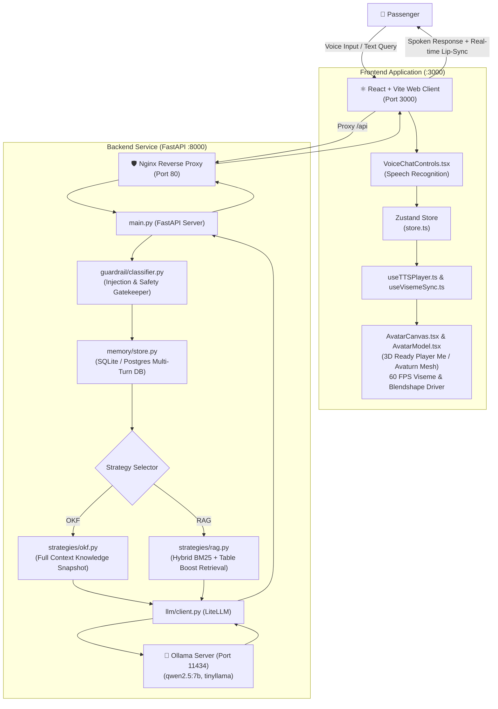

# 🛫 LCK Airport's AI Assistant

Official AI Talking Avatar and Passenger Kiosk Assistant for **Chaudhary Charan Singh International Airport (LCK / VILK)**, Lucknow, India.

---

## 📖 Welcome, Developers!

If you are new to **Python** or **React**, this repository is organized cleanly with dedicated beginner guides for each subsystem:

* 🐍 **Backend Developer Guide (FastAPI, Python 3.12, LiteLLM)**: [`backend/README.md`](file:///Users/chandrakumar/Documents/airport_project/lck_airport/backend/README.md)
* ⚛️ **Frontend Developer Guide (React, Vite, Three.js 3D Avatar)**: [`frontend/README.md`](file:///Users/chandrakumar/Documents/airport_project/lck_airport/frontend/README.md)
* 📋 **Architectural Blueprints & Specs**: [`readme_files/`](file:///Users/chandrakumar/Documents/airport_project/lck_airport/readme_files/)

---

## 🏛️ System Architecture



---

## 📁 Repository Skeleton

```
lck_airport/
├── README.md               # Master Project Guide (You are here)
├── .gitignore              # Project-wide Git ignore rules
│
├── backend/                # FastAPI Python Backend
│   ├── README.md           # 📖 Step-by-step Python & FastAPI beginner guide
│   ├── compose.yaml        # Docker Compose configuration (FastAPI + Nginx)
│   ├── pyproject.toml      # Python dependencies
│   ├── .env.example        # Environment variable template
│   ├── docker/             # Dockerfiles for backend and Nginx reverse proxy
│   └── src/lck_backend/    # Python application source code
│       ├── main.py         # Entry point and lifespan
│       ├── api/            # REST API endpoints (/chat, /health, /knowledge)
│       ├── core/           # Configuration, logging, and error classes
│       ├── guardrail/      # Safety and prompt injection filter
│       ├── knowledge/      # Knowledge snapshot manager
│       ├── llm/            # LiteLLM client wrapper
│       ├── memory/         # Session memory and SQLite/PostgreSQL store
│       ├── retrieval/      # Table-aware chunking and BM25 index
│       ├── schemas/        # Pydantic data schemas
│       ├── services/       # Chat orchestration service
│       └── strategies/     # OKF and RAG strategy implementations
│
├── frontend/               # React + Vite + TypeScript Web Client
│   ├── README.md           # 📖 Step-by-step React & 3D Three.js beginner guide
│   ├── index.html          # HTML template
│   ├── package.json        # NPM dependencies (@react-three/fiber, three, etc.)
│   ├── vite.config.ts      # Vite dev server and proxy configuration
│   ├── public/             # Static files (app icon, 3D avatar GLB models)
│   │   ├── app-icon.jpg    # Official airport assistant icon
│   │   └── avatars/        # 3D models with 72 facial viseme blendshapes
│   │       ├── lck_assistant.glb  # Officer 1: Customer Service Officer
│   │       └── avaturn.glb        # Officer 2: Photorealistic Avaturn Agent
│   └── src/
│       ├── App.tsx         # Main interactive kiosk application
│       ├── store.ts        # Global Zustand state store
│       ├── components/     # React UI components (AvatarCanvas, VoiceChatControls)
│       └── hooks/          # Custom hooks (useTTSPlayer, useVisemeSync)
│
├── data/                   # Verified LCK Airport Knowledge Base
│   ├── manifest.json       # Declarative document inventory and checksum rules
│   ├── unknown_traps.json  # Benchmark questions to test closed-world abstention
│   └── lck_airport/        # Official airport documentation
│       ├── amenities.md    # Lounges, prayer rooms, medical, WiFi
│       ├── faq.md          # Spoken Q&A answers
│       ├── gates.md        # Gates, concourses, boarding procedures
│       ├── hours.md        # Terminal operational hours and contact numbers
│       ├── security.md     # Baggage screening and allowed liquids
│       ├── terminals.md    # Terminal 1, 2, and 3 airline allocations
│       ├── transport.md    # Metro, parking tariffs, taxi, shuttles
│       ├── hi/             # Hindi translations (gates, amenities, faq)
│       └── es/             # Spanish translations (gates, amenities, faq)
│
└── readme_files/           # Technical Architecture Specifications
    ├── initial-requirement.md # Original airport requirements
    ├── backend.md          # Deep-dive backend specification
    └── frontend.md         # Deep-dive frontend specification
```

---

## ⚡ Quickstart Guide

### 1. Prerequisites
* **Docker & Docker Compose** installed.
* **Ollama** running locally on host (`http://127.0.0.1:11434`) with `qwen2.5:7b` installed:
  ```bash
  ollama run qwen2.5:7b
  ```
* **Node.js 18+** and **npm** installed.

---

### 2. Start the Backend (Port 80)
From the project root:
```bash
cd backend
docker-compose up -d --build
```
* Verify health:
  ```bash
  curl http://localhost/api/v1/health
  ```
* Expected response: `{"status": "healthy", "services": {"ollama": {"status": "connected"}, ...}}`

---

### 3. Start the Frontend (Port 3000)
In a separate terminal:
```bash
cd frontend
npm install
npm run dev
```
* Open your browser at **[http://localhost:3000](http://localhost:3000)**.
* Click **"Test Voice"** on the avatar card to watch the 3D avatar speak and lip-sync.
* Speak or type your flight and terminal questions in English, Hindi, or Spanish!
