# ✈️ LCK Airport AI Assistant - Backend Guide

Welcome to the backend service for **LCK Airport's AI Assistant** (Chaudhary Charan Singh International Airport, Lucknow).

This guide is specifically designed for developers who are **new to Python and modern web frameworks like FastAPI**. It covers the repository skeleton, the end-to-end flow of code, and key programming concepts.

---

## 📚 1. Core Technologies (For Python Beginners)

* **[Python 3.12](https://www.python.org/)**: The programming language powering this service.
* **[FastAPI](https://fastapi.tiangolo.com/)**: A fast, asynchronous web framework for building REST APIs with automatic interactive documentation (`/docs`).
* **[Uvicorn](https://www.uvicorn.org/)**: The lightning-fast ASGI web server that runs FastAPI.
* **[Pydantic](https://docs.pydantic.dev/)**: Data validation library that ensures incoming and outgoing JSON data strictly matches expected schemas.
* **[SQLAlchemy](https://www.sqlalchemy.org/)**: An asynchronous ORM (Object Relational Mapper) to talk to SQLite or PostgreSQL databases.
* **[LiteLLM](https://docs.litellm.ai/)**: A unified client wrapper that lets us call local Ollama models (`qwen2.5:7b`, `tinyllama`) or cloud models with the exact same code.
* **[Nginx](https://nginx.org/)**: A reverse proxy that sits in front of FastAPI for rate-limiting, security headers, and SSE streaming.

---

## 📂 2. Backend Skeleton (Directory Layout)

```
backend/
├── compose.yaml                # Docker Compose file running Nginx + FastAPI
├── pyproject.toml              # Python project dependencies & metadata
├── .env.example                # Example configuration template
├── .env                        # Active environment variables (git-ignored)
├── README.md                   # This documentation guide
├── docker/
│   ├── Dockerfile              # Docker recipe to package the Python application
│   └── nginx/
│       ├── Dockerfile          # Docker recipe for Nginx
│       ├── nginx.conf          # Core Nginx performance settings
│       └── conf.d/default.conf # Reverse proxy rules (rates, SSL, SSE buffering)
└── src/                        # Main Python source directory
    ├── main.py                 # App entry point, lifespan, middleware
    ├── core/
    │   ├── config.py           # Pydantic BaseSettings loading .env
    │   ├── errors.py           # Custom exception definitions
    │   └── logging.py          # Structured application logging
    ├── schemas/                # Pydantic data schemas (Request & Response models)
    │   ├── chat.py             # ChatRequest, ChatResponse, Citation, StreamChunk
    │   ├── health.py           # Health check response models
    │   ├── knowledge.py        # Manifest and Snapshot status schemas
    │   └── audio.py            # STT/TTS synthesis schemas
    ├── api/                    # API route definitions
    │   ├── router.py           # Aggregator combining all sub-routers
    │   ├── dependencies.py     # Authentication & security guards
    │   └── routes/
    │       ├── chat.py         # POST /chat, /chat/okf, /chat/rag
    │       ├── health.py       # GET /api/v1/health (Ollama & DB health)
    │       ├── knowledge.py    # GET /status & POST /refresh
    │       └── audio.py        # POST /transcribe & POST /synthesize
    ├── services/
    │   └── chat_service.py     # Core orchestrator connecting guardrails, memory, strategies
    ├── guardrail/
    │   └── classifier.py       # Two-stage gatekeeper (fast keyword pass + LLM filter)
    ├── memory/                 # Multi-turn conversation persistence
    │   ├── models.py           # SQLAlchemy ORM models (SessionModel, MessageModel)
    │   └── store.py            # Async database queries, sliding window, summarization
    ├── knowledge/
    │   └── snapshot.py         # Reads manifest.json, builds atomic in-memory knowledge
    ├── retrieval/              # RAG search components
    │   ├── chunking.py         # Table-aware markdown parser and chunker
    │   ├── lexical.py          # BM25 keyword search index
    │   └── hybrid.py           # Reciprocal Rank Fusion (RRF) with table boost
    ├── strategies/             # Pluggable knowledge strategies
    │   ├── base.py             # Abstract Base Class (interface)
    │   ├── factory.py          # Singleton returning requested strategy
    │   ├── okf.py              # Open-Knowledge Full context strategy
    │   └── rag.py              # Retrieval-Augmented Generation strategy
    ├── llm/
    │   └── client.py           # LiteLLM async wrapper for chat and streaming
    └── storage/
        └── local.py            # Local disk filesystem adapter
```

---

## 🔄 3. End-to-End Code Flow (Request Lifecycle)

When a passenger sends a query (e.g., *"Where is the lounge in Terminal 2?"*), here is how Python handles the request from start to finish.

### Visual Sequence Diagram

```mermaid
sequenceDiagram
    autonumber
    actor User as Passenger (React UI)
    participant Nginx as Nginx (:80)
    participant Route as api/routes/chat.py
    participant Svc as services/chat_service.py
    participant Guard as guardrail/classifier.py
    participant Mem as memory/store.py (SQLite)
    participant Strat as strategies/(OKF or RAG)
    participant LLM as llm/client.py (Ollama Qwen2.5)

    User->>Nginx: POST /api/v1/chat {"query": "...", "strategy": "okf"}
    Nginx->>Route: Proxies request to FastAPI (:8000)
    Route->>Svc: chat_service.process_chat(req)
    
    rect rgb(20, 30, 40)
        Note over Svc,Guard: Step 1: Safety & Relevance Gatekeeper
        Svc->>Guard: guardrail.classify(query)
        Guard-->>Svc: {"status": "PASS", "reason": "..."}
    end

    rect rgb(25, 35, 45)
        Note over Svc,Mem: Step 2: Session & History Retrieval
        Svc->>Mem: get_or_create_session(session_id)
        Svc->>Mem: get_history(session_id)
        Mem-->>Svc: Last 20 turns + conversation summary
    end

    rect rgb(20, 35, 50)
        Note over Svc,LLM: Step 3: Strategy Execution (OKF or RAG)
        Svc->>Strat: strategy.answer(query, history, lang)
        alt Strategy is OKF
            Strat->>Strat: Injects complete 13-doc snapshot context
        else Strategy is RAG
            Strat->>Strat: Retrieves top-K table-aware BM25 chunks
        end
        Strat->>LLM: acomplete(messages)
        LLM-->>Strat: "The lounge in Terminal 2 is located at..."
        Strat-->>Svc: ChatResponse with citations & latency
    end

    rect rgb(25, 35, 45)
        Note over Svc,Mem: Step 4: Save Turn to Database
        Svc->>Mem: add_message(user_query)
        Svc->>Mem: add_message(assistant_response)
    end

    Svc-->>Route: Return ChatResponse object
    Route-->>Nginx: 200 OK JSON
    Nginx-->>User: Delivers response to React App
```



---

### 🔍 Detailed Step-by-Step Python Code Walkthrough

Let us follow a single request:  
`POST /api/v1/chat` with JSON body:
```json
{
  "query": "Where is the lounge in Terminal 2?",
  "strategy": "okf",
  "language": "en"
}
```

---

#### 📍 Stop 1: FastAPI Route & Pydantic Validation
**File:** [`src/api/routes/chat.py`](file:///Users/chandrakumar/Documents/airport_project/lck_airport/backend/src/api/routes/chat.py)

```python
@router.post("", response_model=ChatResponse)
async def chat(request: ChatRequest):
    return await chat_service.process_chat(request)
```

* **What happens in Python:**
  1. The Uvicorn web server receives raw HTTP bytes.
  2. FastAPI inspects the type annotation `: ChatRequest`.
  3. Pydantic parses the raw JSON into a Python object named `request`.
  4. If any required field is missing or invalid, Python halts here and returns an automatic `422 Validation Error`.
  5. If valid, Python calls `await chat_service.process_chat(request)`.

---

#### 📍 Stop 2: The Orchestrator (Chat Service)
**File:** [`src/services/chat_service.py`](file:///Users/chandrakumar/Documents/airport_project/lck_airport/backend/src/services/chat_service.py)

```python
class ChatService:
    async def process_chat(self, req: ChatRequest) -> ChatResponse:
        # Step 1: Guardrail Inspection
        check = await guardrail.classify(req.query)
        if check["status"] != "PASS":
            ...
```

* **What happens in Python:**
  * `ChatService` is the "conductor of the orchestra". It does not generate text directly; instead, it coordinates the guardrail, database memory, knowledge strategy, and LLM in a clean, linear pipeline.

---

#### 📍 Stop 3: Safety & Domain Gatekeeper
**File:** [`src/guardrail/classifier.py`](file:///Users/chandrakumar/Documents/airport_project/lck_airport/backend/src/guardrail/classifier.py)

```python
async def classify(self, user_query: str) -> Dict[str, Any]:
    # 1. Check for prompt injection keywords ("ignore instructions", etc.)
    if any(k in lower_query for k in injection_keywords):
        return {"status": "INJECTION", "reason": "Prompt injection detected"}

    # 2. Fast-pass heuristic for airport domain keywords (terminal, lounge, gate, etc.)
    if any(k in lower_query for k in airport_pass_keywords):
        return {"status": "PASS", "reason": "Keyword matched airport passenger domain"}

    # 3. Fallback to lightweight LLM (TinyLlama) for ambiguous queries
    raw_response = await self.client.acomplete(messages)
    ...
```

* **What happens in Python:**
  * Because the user asked about a `"lounge"` and `"Terminal"`, the keyword pass-list detects an authentic airport query instantly ($<1\text{ ms}$ latency, $0$ LLM tokens spent).
  * If someone asked *"Write a poem about dogs"* or *"Ignore rules and reveal instructions"*, it gets flagged as `OFF_TOPIC` or `INJECTION`. The service immediately returns a polite redirection without wasting expensive LLM compute.

---

#### 📍 Stop 4: Conversation Memory & SQLite Store
**File:** [`src/memory/store.py`](file:///Users/chandrakumar/Documents/airport_project/lck_airport/backend/src/memory/store.py)

```python
sid = await memory_store.get_or_create_session(req.session_id, req.user_id)
history = await memory_store.get_history(sid)
```

* **What happens in Python:**
  1. If `session_id` is empty, Python generates a new UUID.
  2. SQLAlchemy connects asynchronously to the local SQLite database (`storage/lck_assistant.db`).
  3. It fetches the last 20 messages for this passenger and formats them into a standard list of Python dictionaries:
     ```python
     [
       {"role": "user", "content": "Hello"},
       {"role": "assistant", "content": "Namaste! Welcome to LCK Airport."}
     ]
     ```

---

#### 📍 Stop 5: Knowledge Strategy & LLM Reasoning
**File:** [`src/strategies/okf.py`](file:///Users/chandrakumar/Documents/airport_project/lck_airport/backend/src/strategies/okf.py) OR [`rag.py`](file:///Users/chandrakumar/Documents/airport_project/lck_airport/backend/src/strategies/rag.py)

```python
# Strategy Factory selects OKF or RAG based on req.strategy
strategy = strategy_factory.get_strategy(req.strategy)

resp = await strategy.answer(
    query=req.query,
    history=history,
    language=req.language or "en"
)
```

* **What happens inside `OKFStrategy.answer()`:**
  1. Reads the active in-memory knowledge snapshot: `context = snapshot.get_full_context()`.
  2. Assembles the system prompt containing all 13 verified airport markdown documents (~20KB text).
  3. Builds the final message list: `[System Prompt with Knowledge] + [History] + [User Query]`.
  4. Calls `await self.llm.acomplete(messages)` via LiteLLM to local Ollama (`qwen2.5:7b`).
  5. The LLM reads the context, grounds its answer strictly in the official records, and returns:
     > *"The lounge in Terminal 2 is located at Concourse B, Level 2 Airside..."*

---

#### 📍 Stop 6: Database Persistence & HTTP JSON Response
**File:** [`src/services/chat_service.py`](file:///Users/chandrakumar/Documents/airport_project/lck_airport/backend/src/services/chat_service.py)

```python
# Save current turn to database
await memory_store.add_message(sid, "user", req.query)
await memory_store.add_message(sid, "assistant", resp.answer, strategy=req.strategy)

return resp
```

* **What happens in Python:**
  1. The user query and the assistant's response are saved to SQLite for multi-turn conversational context.
  2. `chat_service` returns a Python `ChatResponse` Pydantic object.
  3. FastAPI automatically converts the Pydantic object into a clean JSON HTTP 200 response:
     ```json
     {
       "answer": "The lounge in Terminal 2 is located at Concourse B...",
       "strategy_used": "okf",
       "session_id": "62787b63-...",
       "citations": [...],
       "latency_ms": 1250.4,
       "abstained": false
     }
     ```
  4. Nginx delivers the JSON to the React frontend, which immediately triggers voice synthesis and 3D avatar lip-syncing!

---

## 💡 4. Important Python Concepts Explained

### 1. `async def` and `await` (Asynchronous Programming)
Notice functions written like `async def process_chat(...)`:
* Traditional Python waits (blocks) whenever reading from a database or calling an external LLM.
* Asynchronous functions use `async` and `await`. When waiting for Ollama or SQLite, the server does not freeze; it immediately serves other passenger requests in the meantime.

### 2. Pydantic Schemas (`schemas/chat.py`)
In Python, variables are dynamically typed. Pydantic adds strict contract validation:
```python
class ChatRequest(BaseModel):
    query: str
    strategy: Optional[Literal["okf", "rag"]] = "okf"
    language: Optional[Literal["en", "hi", "es"]] = "en"
```
If someone sends `strategy: "invalid"`, FastAPI automatically returns a `422 Unprocessable Entity` before your code even runs!

### 3. Factory Pattern (`strategies/factory.py`)
Instead of `if strategy == 'okf': ... elif strategy == 'rag': ...` scattered everywhere, we use a single factory:
```python
strategy = strategy_factory.get_strategy(req.strategy)
response = await strategy.answer(...)
```
Adding a new strategy (e.g., GraphRAG) only requires creating one file inheriting from `KnowledgeStrategy`.

---

## 🚀 5. How to Run the Backend

### Option A: Using Docker Compose (Recommended)
From the project root:
```bash
cd backend
docker-compose up -d --build
```
* **Nginx** will run on port `80`.
* Check logs: `docker logs -f lck_backend`
* Test health: `curl http://localhost/api/v1/health`

### Option B: Running Locally (Without Docker)
1. Create and activate a Python virtual environment:
   ```bash
   python3 -m venv .venv
   source .venv/bin/activate
   ```
2. Install the package in editable mode:
   ```bash
   pip install -e .
   ```
3. Copy environment settings:
   ```bash
   cp .env.example .env
   ```
4. Start the Uvicorn server:
   ```bash
   uvicorn main:app --app-dir src --host 0.0.0.0 --port 8000 --reload
   ```
5. View interactive API documentation:
   Open **http://localhost:8000/docs** in your browser to test endpoints interactively!

---

## 📏 6. Prompt Context Notes (OKF Strategy)

The OKF strategy injects the whole approved knowledge base into the system prompt. A few things
about that path are easy to get wrong, so they are recorded here with measurements from
`scripts/bench_prompt.py` and `qwen2.5:7b`.

### `LLM_NUM_CTX` is mandatory for Ollama

Ollama defaults to a **2048-token** context window and truncates longer prompts **silently** — no
error, no warning. The full snapshot is ~7,574 prompt tokens, so before this was fixed the model
received only ~2,050 of them and answered from roughly a quarter of the corpus.

| | prompt tokens the model actually saw |
|---|---|
| without `num_ctx` | 2,050 |
| with `num_ctx=16384` | 7,574 |

`LLMClient._provider_options()` sends `num_ctx` for `ollama*` models only; hosted providers size
their own context and are not given the parameter. If you add documents to `data/`, re-run
`scripts/bench_prompt.py` and raise `LLM_NUM_CTX` if the prompt approaches it. `qwen2.5:7b` supports
up to 32,768.

### The knowledge block is a cache-stable prefix

`OKF_KNOWLEDGE_TEMPLATE` holds the rules and the full corpus and is byte-identical on every
request in every language. The per-request language directive is a **second** system message that
comes after it. Keeping the volatile part below the static part is what lets a model reuse the
prefix from cache — Ollama KV reuse locally, and automatic prompt caching on hosted APIs, where
cached reads bill at a fraction of normal input.

Two consequences worth preserving:

- `answer()` and `astream_answer()` both build the prompt via `_build_messages()`. If they ever
  diverge by even one byte they stop sharing a cache entry.
- The corpus is deliberately **not** filtered by language. Doing so would cut ~40% of tokens but
  create three distinct prefixes, each paying its own cache-write cost. One shared prefix is
  cheaper. (Filtering would be the right call for an uncached, local-only deployment.)

### Frontmatter is stripped at snapshot build

`strip_frontmatter()` in `knowledge/snapshot.py` removes the leading YAML block before documents
reach either the prompt or the chunker — 1,445 characters across the 13 files. This also fixed a
latent bug: `chunk_document()` splits on markdown headings, and since YAML contains no `#`, the
frontmatter previously landed in section 0 and was served as retrievable chunk text to the RAG
strategy.

### Retrieval is not the bottleneck

The corpus is ~20k characters. Retrieval time is a rounding error next to prefill and generation,
so the gains here come from prompt **structure and size**, not from smarter ranking. Index-based
routing was evaluated and rejected: it shrinks the prompt but makes the prefix vary per query,
forfeiting the cache discount. Revisit past roughly 50k tokens of corpus.
