```mermaid
sequenceDiagram
    autonumber
    actor User as Passenger (React UI)
    participant Nginx as Nginx (:80)
    participant Route as api/routes/chat.py
    participant Svc as services/chat_service.py
    participant Guard as guardrail/classifier.py
    participant Mem as memory/store.py (SQLite)
    participant Strat as strategies/(OKF or RAG)
    participant LLM as llm/client.py (Ollama Qwen2.5)

    User->>Nginx: POST /api/v1/chat {"query": "...", "strategy": "okf"}
    Nginx->>Route: Proxies request to FastAPI (:8000)
    Route->>Svc: chat_service.process_chat(req)
    
    rect rgb(20, 30, 40)
        Note over Svc,Guard: Step 1: Safety & Relevance Gatekeeper
        Svc->>Guard: guardrail.classify(query)
        Guard-->>Svc: {"status": "PASS", "reason": "..."}
    end

    rect rgb(25, 35, 45)
        Note over Svc,Mem: Step 2: Session & History Retrieval
        Svc->>Mem: get_or_create_session(session_id)
        Svc->>Mem: get_history(session_id)
        Mem-->>Svc: Last 20 turns + conversation summary
    end

    rect rgb(20, 35, 50)
        Note over Svc,LLM: Step 3: Strategy Execution (OKF or RAG)
        Svc->>Strat: strategy.answer(query, history, lang)
        alt Strategy is OKF
            Strat->>Strat: Injects complete 13-doc snapshot context
        else Strategy is RAG
            Strat->>Strat: Retrieves top-K table-aware BM25 chunks
        end
        Strat->>LLM: acomplete(messages)
        LLM-->>Strat: "The lounge in Terminal 2 is located at..."
        Strat-->>Svc: ChatResponse with citations & latency
    end

    rect rgb(25, 35, 45)
        Note over Svc,Mem: Step 4: Save Turn to Database
        Svc->>Mem: add_message(user_query)
        Svc->>Mem: add_message(assistant_response)
    end

    Svc-->>Route: Return ChatResponse object
    Route-->>Nginx: 200 OK JSON
    Nginx-->>User: Delivers response to React App
```

# ✈️ LCK Airport AI Assistant - Backend Guide

Welcome to the backend service for **LCK Airport's AI Assistant** (Chaudhary Charan Singh International Airport, Lucknow).

This guide is specifically designed for developers who are **new to Python and modern web frameworks like FastAPI**. It covers the repository skeleton, the end-to-end flow of code, and key programming concepts.

---

## 📚 1. Core Technologies (For Python Beginners)

* **[Python 3.12](https://www.python.org/)**: The programming language powering this service.
* **[FastAPI](https://fastapi.tiangolo.com/)**: A fast, asynchronous web framework for building REST APIs with automatic interactive documentation (`/docs`).
* **[Uvicorn](https://www.uvicorn.org/)**: The lightning-fast ASGI web server that runs FastAPI.
* **[Pydantic](https://docs.pydantic.dev/)**: Data validation library that ensures incoming and outgoing JSON data strictly matches expected schemas.
* **[SQLAlchemy](https://www.sqlalchemy.org/)**: An asynchronous ORM (Object Relational Mapper) to talk to SQLite or PostgreSQL databases.
* **[LiteLLM](https://docs.litellm.ai/)**: A unified client wrapper that lets us call local Ollama models (`qwen2.5:7b`, `tinyllama`) or cloud models with the exact same code.
* **[Nginx](https://nginx.org/)**: A reverse proxy that sits in front of FastAPI for rate-limiting, security headers, and SSE streaming.

---

## 📂 2. Backend Skeleton (Directory Layout)

```
backend/
├── compose.yaml                # Docker Compose file running Nginx + FastAPI
├── pyproject.toml              # Python project dependencies & metadata
├── .env.example                # Example configuration template
├── .env                        # Active environment variables (git-ignored)
├── README.md                   # This documentation guide
├── docker/
│   ├── Dockerfile              # Docker recipe to package the Python application
│   └── nginx/
│       ├── Dockerfile          # Docker recipe for Nginx
│       ├── nginx.conf          # Core Nginx performance settings
│       └── conf.d/default.conf # Reverse proxy rules (rates, SSL, SSE buffering)
└── src/
    └── lck_backend/            # Main Python package directory
        ├── main.py             # App entry point, lifespan, middleware
        ├── core/
        │   ├── config.py       # Pydantic BaseSettings loading .env
        │   ├── errors.py       # Custom exception definitions
        │   └── logging.py      # Structured application logging
        ├── schemas/            # Pydantic data schemas (Request & Response models)
        │   ├── chat.py         # ChatRequest, ChatResponse, Citation, StreamChunk
        │   ├── health.py       # Health check response models
        │   ├── knowledge.py    # Manifest and Snapshot status schemas
        │   └── audio.py        # STT/TTS synthesis schemas
        ├── api/                # API route definitions
        │   ├── router.py       # Aggregator combining all sub-routers
        │   ├── dependencies.py # Authentication & security guards
        │   └── routes/
        │       ├── chat.py     # POST /api/v1/chat (Core chat & streaming)
        │       ├── health.py   # GET /api/v1/health (Ollama & DB health)
        │       ├── knowledge.py# GET /status & POST /refresh
        │       └── audio.py    # POST /transcribe & POST /synthesize
        ├── services/
        │   └── chat_service.py # Core orchestrator connecting guardrails, memory, strategies
        ├── guardrail/
        │   └── classifier.py   # Two-stage gatekeeper (fast keyword pass + LLM filter)
        ├── memory/             # Multi-turn conversation persistence
        │   ├── models.py       # SQLAlchemy ORM models (SessionModel, MessageModel)
        │   └── store.py        # Async database queries, sliding window, summarization
        ├── knowledge/
        │   └── snapshot.py     # Reads manifest.json, builds atomic in-memory knowledge
        ├── retrieval/          # RAG search components
        │   ├── chunking.py     # Table-aware markdown parser and chunker
        │   ├── lexical.py      # BM25 keyword search index
        │   └── hybrid.py       # Reciprocal Rank Fusion (RRF) with table boost
        ├── strategies/         # Pluggable knowledge strategies
        │   ├── base.py         # Abstract Base Class (interface)
        │   ├── factory.py      # Singleton returning requested strategy
        │   ├── okf.py          # Open-Knowledge Full context strategy
        │   └── rag.py          # Retrieval-Augmented Generation strategy
        ├── llm/
        │   └── client.py       # LiteLLM async wrapper for chat and streaming
        └── storage/
            └── local.py        # Local disk filesystem adapter
```

---

## 🔄 3. End-to-End Code Flow (Request Lifecycle)

When a passenger sends a query (e.g., *"Where is the lounge in Terminal 2?"*), here is the step-by-step path the code follows:



---

## 💡 4. Important Python Concepts Explained

### 1. `async def` and `await` (Asynchronous Programming)
Notice functions written like `async def process_chat(...)`:
* Traditional Python waits (blocks) whenever reading from a database or calling an external LLM.
* Asynchronous functions use `async` and `await`. When waiting for Ollama or SQLite, the server does not freeze; it immediately serves other passenger requests in the meantime.

### 2. Pydantic Schemas (`schemas/chat.py`)
In Python, variables are dynamically typed. Pydantic adds strict contract validation:
```python
class ChatRequest(BaseModel):
    query: str
    strategy: Optional[Literal["okf", "rag"]] = "okf"
    language: Optional[Literal["en", "hi", "es"]] = "en"
```
If someone sends `strategy: "invalid"`, FastAPI automatically returns a `422 Unprocessable Entity` before your code even runs!

### 3. Factory Pattern (`strategies/factory.py`)
Instead of `if strategy == 'okf': ... elif strategy == 'rag': ...` scattered everywhere, we use a single factory:
```python
strategy = strategy_factory.get_strategy(req.strategy)
response = await strategy.answer(...)
```
Adding a new strategy (e.g., GraphRAG) only requires creating one file inheriting from `KnowledgeStrategy`.

---

## 🚀 5. How to Run the Backend

### Option A: Using Docker Compose (Recommended)
From the project root:
```bash
cd backend
docker-compose up -d --build
```
* **Nginx** will run on port `80`.
* Check logs: `docker logs -f lck_backend`
* Test health: `curl http://localhost/api/v1/health`

### Option B: Running Locally (Without Docker)
1. Create and activate a Python virtual environment:
   ```bash
   python3 -m venv .venv
   source .venv/bin/activate
   ```
2. Install the package in editable mode:
   ```bash
   pip install -e .
   ```
3. Copy environment settings:
   ```bash
   cp .env.example .env
   ```
4. Start the Uvicorn server:
   ```bash
   uvicorn lck_backend.main:app --host 0.0.0.0 --port 8000 --reload
   ```
5. View interactive API documentation:
   Open **http://localhost:8000/docs** in your browser to test endpoints interactively!
