# 🎨 LCK Airport AI Assistant - Frontend Guide

Welcome to the frontend application for **LCK Airport's AI Assistant** (Chaudhary Charan Singh International Airport, Lucknow).

This guide is specifically designed for developers who are **new to React, TypeScript, and 3D web graphics (Three.js / React Three Fiber)**. It explains the project skeleton, code execution flow, and how the 3D avatar lip-syncs with voice output.

---

## 📚 1. Core Technologies (For React Beginners)

* **[React 18](https://react.dev/)**: The popular component-based UI library that renders the user interface.
* **[Vite](https://vitejs.dev/)**: Next-generation frontend build tool that provides instant Hot Module Replacement (HMR) during development and bundles the app for production.
* **[TypeScript](https://www.typescriptlang.org/)**: A typed superset of JavaScript that prevents runtime errors by checking object shapes and types before code runs.
* **[Tailwind CSS](https://tailwindcss.com/)**: Utility-first CSS framework for styling components with modern gradients, animations, and responsive grids.
* **[Zustand](https://zustand.docs.pmnd.rs/)**: A simple, fast, centralized state store (like Redux, but with 90% less boilerplate).
* **[React Three Fiber (R3F)](https://r3f.docs.pmnd.rs/)**: A React wrapper for [Three.js](https://threejs.org/) that lets us build WebGL 3D scenes using standard declarative React components.
* **[@react-three/drei](https://github.com/pmndrs/drei)**: A collection of useful helpers for R3F, including `useGLTF` (model loading), `OrbitControls` (camera navigation), and studio environments.
* **[Web Speech API](https://developer.mozilla.org/en-US/docs/Web/API/Web_Speech_API)**: Browser-native APIs for Speech-to-Text (`SpeechRecognition`) and Text-to-Speech (`SpeechSynthesis`).

---

## 📂 2. Frontend Skeleton (Directory Layout)

```
frontend/
├── index.html                      # HTML entry point (loads favicon & /src/main.tsx)
├── package.json                    # Dependencies, scripts (dev, build, preview)
├── vite.config.ts                  # Vite configuration & proxy (/api -> :80)
├── tsconfig.json                   # TypeScript compiler configuration
├── tailwind.config.js              # Custom aviation color palette and animations
├── postcss.config.js               # CSS preprocessor configuration
├── public/                         # Static assets served directly at root /
│   ├── app-icon.jpg                # Official LCK Assistant icon
│   ├── favicon.ico                 # Browser tab favicon
│   └── avatars/                    # 3D GLTF/GLB digital human models
│       ├── lck_assistant.glb       # Officer 1: Customer Service Officer (with 72 visemes)
│       └── avaturn.glb             # Officer 2: Photorealistic Avaturn Agent
└── src/
    ├── main.tsx                    # React application bootstrap and root mount
    ├── App.tsx                     # Top-level application layout & kiosk orchestration
    ├── index.css                   # Global styles, Tailwind directives, glow effects
    ├── types.ts                    # TypeScript interfaces (Message, LanguageCode, AppState)
    ├── store.ts                    # Global Zustand store (shared app state)
    ├── assets/                     # Static bundled assets
    ├── components/
    │   ├── TranscriptList.tsx      # Chat transcript bubble list with verified citations
    │   ├── avatar/
    │   │   ├── AvatarCanvas.tsx    # R3F Canvas, 3-point lighting, status badges, model toggle
    │   │   ├── AvatarModel.tsx     # 3D model loader, viseme driver, blinking, head micro-sway
    │   │   └── visemeMap.ts        # Phoneme-to-viseme maps, timing generator for 15 blendshapes
    │   └── voice/
    │       └── VoiceChatControls.tsx # Microphone button, quick chips, text input, API dispatcher
    └── hooks/
        ├── useVisemeSync.ts        # Interpolates viseme weights per frame with attack/release envelopes
        └── useTTSPlayer.ts         # Coordinates Web Speech API audio with useVisemeSync
```

---

## 🔄 3. End-to-End Frontend Flow (Voice & Lip-Sync Lifecycle)

The primary innovation of this frontend is **real-time 3D human lip-syncing synchronized with voice audio**. Here is how the pieces communicate:

```mermaid
sequenceDiagram
    autonumber
    actor User as Passenger
    participant Controls as VoiceChatControls.tsx
    participant Store as store.ts (Zustand)
    participant Backend as FastAPI Backend (/api/v1/chat)
    participant TTS as useTTSPlayer.ts
    participant VisemeSync as useVisemeSync.ts
    participant R3F as AvatarCanvas & AvatarModel.tsx

    User->>Controls: Speaks into microphone or types query
    Controls->>Store: addMessage({ sender: 'user', text: "Where is the lounge?" })
    Controls->>Backend: fetch('/api/v1/chat', { query, strategy, language })
    Backend-->>Controls: Returns JSON { answer: "Terminal 2 lounge is...", citations: [...] }
    Controls->>Store: addMessage({ sender: 'assistant', text: answer })
    Controls->>TTS: onSpeakResponse(answer)

    rect rgb(20, 35, 50)
        Note over TTS,VisemeSync: Audio Speech & Timeline Initialization
        TTS->>TTS: cleanTextForSpeech(answer) (removes markdown/brackets)
        TTS->>Store: setIsSpeaking(true)
        TTS->>VisemeSync: startSpeaking(text, speechRate)
        VisemeSync->>VisemeSync: generateVisemeCuesFromText(text)
        TTS->>User: window.speechSynthesis.speak(utterance) (Audio plays)
    end

    rect rgb(30, 45, 30)
        Note over R3F,VisemeSync: 60 FPS Render Loop (useFrame)
        loop Every animation frame (approx. 16.6ms)
            R3F->>VisemeSync: getCurrentViseme()
            VisemeSync-->>R3F: { visemeName: "viseme_aa", weight: 0.85 }
            R3F->>R3F: Updates SkinnedMesh morphTargetInfluences (Face + Teeth + Tongue)
            R3F->>R3F: Drives jawOpen, eye blinking, and conversational head sway
        end
    end

    TTS->>VisemeSync: stopSpeaking() (When utterance finishes)
    TTS->>Store: setIsSpeaking(false)
```



---

## 💡 4. Important React Concepts Explained

### 1. Components & JSX (`App.tsx`)
In React, the UI is split into reusable functions called **components** that return HTML-like syntax called **JSX**:
```tsx
export const App: React.FC = () => {
  return (
    <div className="min-h-screen bg-slate-950">
      <header>...</header>
      <main>
        <AvatarCanvas />
        <TranscriptList />
      </main>
    </div>
  );
};
```

### 2. Global State with Zustand (`store.ts`)
Instead of passing props down 5 levels of components, any component can read or write global state instantly:
```tsx
// Inside any component:
const { language, setLanguage, isSpeaking } = useAppStore();
```
When `isSpeaking` flips from `false` to `true`, only the components displaying speaking badges re-render automatically.

### 3. Custom Hooks (`useTTSPlayer.ts`, `useVisemeSync.ts`)
Hooks are functions starting with `use` that package logic cleanly away from UI components:
* `useTTSPlayer()` handles speech synthesis and voice matching.
* `useVisemeSync()` generates the viseme timing queue and calculates mathematical weight curves (attack and release) so the avatar's lips move smoothly rather than snapping abruptly.

### 4. 3D WebGL in React (`AvatarModel.tsx`)
React Three Fiber gives us a hook called `useFrame`:
```tsx
useFrame((state, delta) => {
  const { visemeName, weight } = getCurrentViseme();
  // Smoothly blend the 3D mesh's mouth blendshape to target weight
  mesh.morphTargetInfluences[dict[visemeName]] = THREE.MathUtils.lerp(prev, weight, delta * 24);
});
```
`useFrame` executes once per rendered frame (60 times per second), updating the 3D character's vertices before the canvas is drawn to the screen.

---

## 🚀 5. How to Run the Frontend

1. Ensure the backend (or Nginx) is running on port `80` so API requests proxy correctly.
2. In the `frontend` directory:
   ```bash
   cd frontend
   npm install
   npm run dev
   ```
3. Open your browser at **[http://localhost:3000](http://localhost:3000)**.
4. Click the **"Test Voice"** button on the avatar card to test lip-sync and audio speech instantly!

