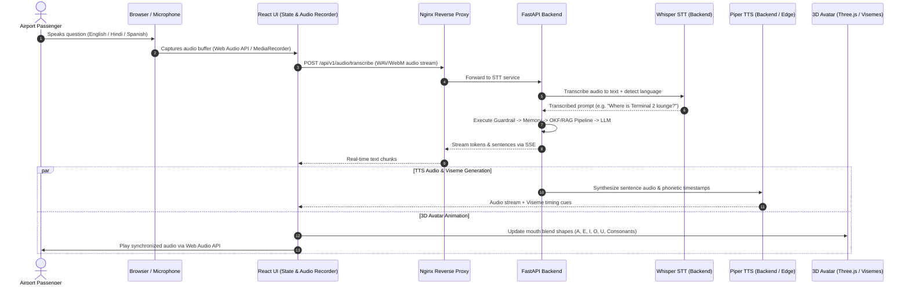

# LCK Airport's AI Assistant — Frontend Architecture

## 1. Project Overview

The frontend is a modern **React (Vite + TypeScript)** application serving as the interactive UI and kiosk interface for **LCK Airport's AI Assistant** (Chaudhary Charan Singh International Airport, Lucknow).

It provides an interactive, hands-free conversational experience:
1. **Listens** to user voice input via microphone (multilingual: English, Hindi, Spanish).
2. **Converts speech to text (STT)** using server-side OpenAI Whisper (`faster-whisper`).
3. **Sends text query** to the backend API (`/api/v1/chat`) via Nginx.
4. **Receives streaming response** (SSE) or full text.
5. **Converts response text to speech (TTS)** using low-latency Piper TTS.
6. **Animates a 3D Avatar with real-time lip-sync** using Ready Player Me 3D model, Three.js / React Three Fiber, and phoneme-to-viseme mapping.

---

## 2. End-to-End Voice & Avatar Flow



---

## 3. Technology Stack

| Layer | Component | Choice | Justification |
|---|---|---|---|
| **Framework** | UI Framework | **React 18 / 19 + TypeScript + Vite** | High performance, instant hot-reload, clean component architecture |
| **Styling** | CSS / Components | **Tailwind CSS + Lucide Icons** | Responsive, airport-kiosk optimized, touch-friendly UI |
| **STT (Speech-to-Text)** | Voice Recognition | **Faster-Whisper (Backend API)** | Open-source, high accuracy, supports English, Hindi, and Spanish, zero external cloud fees |
| **TTS (Text-to-Speech)** | Voice Synthesis | **Piper TTS** | Ultra-fast (<100ms latency), open-source, local/edge friendly, supports English, Hindi & Spanish voice models |
| **3D Rendering** | Graphics Engine | **Three.js + React Three Fiber (@react-three/fiber)** | Declarative WebGL rendering in React |
| **Avatar Model** | 3D Digital Human | **Ready Player Me (.glb / .gltf)** | Open-source/free customizable 3D avatar with standard ARKit / Oculus viseme blend shapes |
| **Lip-Sync Engine** | Viseme Synchronization | **Rhubarb Lip-Sync / Web Audio Viseme Mapper** | Maps audio phonemes directly to avatar facial morph targets |
| **State Management** | Global Client State | **Zustand** | Lightweight, simple reactivity for recording state, avatar animations, chat transcripts |

---

## 4. Directory Structure

The frontend will reside under a dedicated `frontend/` directory in the repository root:

```text
airport_project/
│
├── README.md
├── backend.md
├── frontend.md                           # This document
│
├── data/                                 # Shared knowledge & datasets
│   ├── manifest.json
│   ├── lck_airport/
│   └── evaluation/
│
├── backend/                              # Python FastAPI + Docker + Nginx
│   ├── compose.yaml
│   └── ...
│
└── frontend/                             # React Frontend & Avatar Kiosk App
    ├── package.json
    ├── vite.config.ts
    ├── tsconfig.json
    ├── tailwind.config.js
    ├── index.html
    │
    ├── public/
    │   ├── avatars/
    │   │   └── lck_assistant.glb         # Ready Player Me 3D Avatar model with blendshapes
    │   ├── animations/
    │   │   ├── idle.glb                  # Subtle breathing & blinking animation
    │   │   └── talking.glb               # Gentle hand / head movement loop
    │   └── locales/                      # UI localization strings
    │       ├── en.json
    │       ├── hi.json
    │       └── es.json
    │
    └── src/
        ├── main.tsx                      # App entry point
        ├── App.tsx                       # Main layout (Split: 3D Avatar + Chat/Transcript panel)
        │
        ├── components/
        │   ├── avatar/                   # 3D Avatar Rendering & Lip-Sync
        │   │   ├── AvatarCanvas.tsx      # R3F Canvas container with studio lighting
        │   │   ├── AvatarModel.tsx       # GLTF loader, morph targets & skeleton binding
        │   │   ├── VisemeController.ts   # Audio analyser -> Viseme blendshape driver
        │   │   └── IdleAnimations.ts     # Procedural eye blinking and head tilting
        │   │
        │   ├── voice/                    # Voice recording & playback controls
        │   │   ├── PushToTalkButton.tsx  # Touch/click voice record button with ripple animations
        │   │   ├── AudioVisualizer.tsx   # Live waveform visualizer for microphone input
        │   │   └── LanguageSelector.tsx  # English / हिन्दी / Español switch
        │   │
        │   └── chat/                     # Conversation UI
        │       ├── MessageList.tsx       # Transcript of passenger & assistant interaction
        │       ├── MessageBubble.tsx     # Formatted markdown bubbles with source citations
        │       └── QuickQuestions.tsx    # Popular airport FAQs (Gates, Washrooms, Lounges)
        │
        ├── hooks/                        # Custom React Hooks
        │   ├── useVoiceRecorder.ts       # Microphone capture & WebM/WAV stream buffer
        │   ├── useChatStream.ts          # SSE client for /api/v1/chat endpoint
        │   ├── useTTSPlayer.ts           # Piper audio player & sync timekeeper
        │   └── useVisemeSync.ts          # Synchronizes audio playback timestamps to viseme weights
        │
        ├── services/                     # API Communication
        │   ├── api.ts                    # Axios / Fetch client configured with /api/v1 prefix
        │   ├── sttService.ts             # Sends voice buffer to backend STT endpoint
        │   └── ttsService.ts             # Requests voice synthesis stream from backend
        │
        ├── store/                        # State Store (Zustand)
        │   └── useAppStore.ts            # Active language, session_id, recording state, speaking state
        │
        └── types/                        # TypeScript Interfaces
            ├── avatar.ts                 # Viseme types & blendshape indices
            ├── chat.ts                   # Message, Citation, Session types
            └── voice.ts                  # Audio config & language options
```

---

## 5. Multilingual Support (English, Hindi, Spanish)

Lucknow Airport serves domestic and international passengers. The frontend provides native support for:
- **English (`en`)**: General international travelers and domestic flights.
- **Hindi (`hi`)**: Regional travelers across Uttar Pradesh and North India.
- **Spanish (`es`)**: International transit visitors.

### Language Flow:
1. **Auto-Detection & Manual Switch:**
   - Passenger can click/tap quick language buttons: `[ English | हिन्दी | Español ]`.
   - Whisper STT also auto-detects the spoken language from audio chunks.
2. **TTS Voice Matching:**
   - When language is `hi`, Piper TTS triggers the Hindi neural voice model (`hi_IN`).
   - When language is `es`, Piper TTS triggers the Spanish neural voice model (`es_ES` / `es_MX`).
   - When language is `en`, Piper TTS triggers the Indian/British English neural voice model (`en_GB` / `en_IN`).

---

## 6. Real-Time Lip-Sync & Viseme Mapping

The 3D model contains **MPEG-4 / ARKit 52 facial blend shapes**. During speech playback:
- Audio phonemes are mapped to 15 standard **visemes**:
  - `viseme_sil` (Silence / Mouth Closed)
  - `viseme_PP` (P, B, M)
  - `viseme_FF` (F, V)
  - `viseme_TH` (TH)
  - `viseme_DD` (T, D, S, Z)
  - `viseme_kk` (K, G)
  - `viseme_CH` (CH, J, SH)
  - `viseme_SS` (S, Z)
  - `viseme_nn` (N, L)
  - `viseme_RR` (R)
  - `viseme_aa` (AA, AH)
  - `viseme_E` (EH, EY)
  - `viseme_I` (IH, IY)
  - `viseme_O` (OW, AO)
  - `viseme_U` (UW, UH)

### Animation Loop:
```typescript
// Render loop interpolates current viseme weight towards target weight
useFrame((state, delta) => {
  if (isSpeaking) {
    const currentViseme = getCurrentVisemeFromAudioTime(audioElement.currentTime);
    interpolateMorphTarget(mesh, currentViseme, delta * 25);
  } else {
    // Return to neutral closed mouth
    interpolateMorphTarget(mesh, 'viseme_sil', delta * 10);
  }
});
```

---

## 7. Kiosk / Edge Deployment & Offline Capability

- **Self-Contained & Free:** Zero reliance on costly per-minute cloud avatar APIs (like D-ID or HeyGen).
- **GPU Acceleration in Browser:** WebGL hardware acceleration handles 60 FPS 3D avatar rendering directly on kiosk screens or user laptops.
- **Microphone Echo Cancellation:** Uses browser standard `navigator.mediaDevices.getUserMedia({ audio: { echoCancellation: true, noiseSuppression: true } })` to ensure the avatar's own speaking voice doesn't trigger the microphone again.

---

## 8. Frontend Implementation Steps

1. Initialize Vite React + TypeScript project with Tailwind CSS.
2. Set up React Three Fiber canvas and load Ready Player Me 3D model.
3. Implement `VisemeController` for morph target lip-sync.
4. Implement audio recording and client-side streaming to backend STT.
5. Connect chat interface with SSE backend endpoint (`/api/v1/chat`).
6. Hook up Piper TTS audio output with synchronized avatar speech.
7. Add multilingual UI toggles for English, Hindi, and Spanish.

